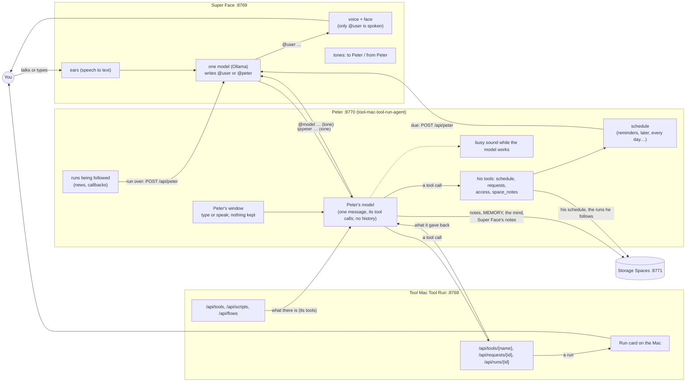

# How it fits together: Super Face, Peter, Tool Mac Tool Run

Three apps on one Mac, each with one job:

| App | Repository | Port | Its job |
|---|---|---|---|
| **Super Face** | [JUST-super-mac-tts-ONLY-service](https://github.com/ainigh/JUST-super-mac-tts-ONLY-service) | 8769 | The face and the conversation. It hears you, thinks with one model, and speaks. It does nothing itself: it asks Peter. |
| **Peter** (Tool Mac Agent) | [tool-mac-tool-run-agent](https://github.com/ainigh/tool-mac-tool-run-agent) | 8770 | His model reads every request in plain words and carries it out with his tools (Tool Mac Tool Run's, Storage Spaces', his own). Answers in plain words. Keeps the schedule and calls clients back. Keeps no conversation. |
| **Tool Mac Tool Run** | [tool-mac-tool-run](https://github.com/ainigh/tool-mac-tool-run) | 8768 | The hands. Scripts, flows, the web, Chrome, notes, MEMORY, the mind, showing and copying, over an HTTP API. A run waits for you to click Run on the Mac. |

## The picture, in the end



### One request, start to end

```mermaid
sequenceDiagram
    participant U as You
    participant S as Super Face (model "qwen3")
    participant P as Peter
    participant M as Peter's model
    participant T as Tool Mac Tool Run

    U->>S: "gonna need an umbrella in Lagos tomorrow?" (shown as "@qwen3 …")
    S->>P: @peter will it rain in Lagos tomorrow? (a tone, not spoken)
    P->>M: the instructions + "From: Super Face, Now: …, will it rain in Lagos tomorrow?" + the tools; busy sound plays
    M-->>P: find {q: "weather"}
    P->>T: POST /api/tools/find
    T-->>P: utilities/weather.py, its inputs
    M-->>P: run_script {utilities/weather.py, [Lagos]}
    P->>T: POST /api/tools/run_script (async)
    T-->>P: 202, waiting for Run on the Mac
    M-->>P: "Asked for the weather in Lagos; you'll hear how it went."
    P-->>S: "@qwen3 Asked for the weather in Lagos; you'll hear how it went." (a tone)
    S-->>U: "@user I've asked for the weather; click Run on your Mac." (spoken)
    U->>T: clicks Run
    T-->>P: (Peter follows the request) finished
    P->>S: POST /api/peter "Meanwhile: the weather finished … Lagos: 70% rain"
    S-->>U: "@user Yes, take an umbrella: 70% chance of rain." (spoken)
```

## The rules

- **Super Face talks only to Peter.** It never calls Tool Mac Tool Run, never loads its list of
  tools, and the model has no tools. Peter is a participant in the chat, not a tool.
- **The model's every answer is addressed.** `@user …` is said aloud to you; `@peter …` goes to
  Peter (a tone plays, nothing is said). Peter's answer comes back as `@<the model's name> …`, as
  if you had answered, and so does what you say. Peter's messages go to the model at once, even
  while you're talking; what you say goes when you finish, and its answer to you is spoken at once.
- **Peter keeps no conversation.** Each message is complete and atomic. His model sees his
  instructions, the one message and its own tool calls for it; never a history. When he asks for
  something or can't do it, his answer says to send the whole request again. What he does keep is
  operational: the runs he's following (so he can call back when they end) and the schedule (on
  disk, and in his space in Storage Spaces).
- **Peter does the translating.** There are no templates: every request goes to his model, which
  calls his tools and writes the answer. A client never learns a format; "how would I ask you to
  …?" gets the words without anything being done. Why: [DECISIONS.md](DECISIONS.md).
- **Peter keeps the time.** "Remind me in 20 minutes…", "every morning, what's the weather" are
  Peter's. When one comes due he does it and calls the client back (`POST /api/peter` for Super
  Face). One that came due while the client was closed comes first in its next answer.
- **Consent stays yours.** A run (a script, a flow, Flow code, Straw) waits for Run on the Mac, every
  time, including scheduled ones. Nothing a model says stands in for that click.
- **Each updates itself** from its GitHub releases, built and published by CI on every push to main.

## The next step (done): Peter's model does it all

What was decided, and why: [DECISIONS.md](DECISIONS.md).

1. **Peter**: the templates, the matcher, the translator, `?exact=true` and the bench taken out.
   Every request goes to his model with his tools (Tool Mac Tool Run's from `GET /api/tools`, and
   his own: `schedule`, `requests`, `access`, `space_notes`), on Ollama's own `/api/chat` (its
   context set), any chat completions address, or Anthropic's Messages API. `/api/say/translator`
   is `/api/model`, which shows his instructions, his tools and each request's tool calls.
2. **Super Face**: its prompt a small example and a short explanation, no templates, no persona.
   Its standing instructions and playbook read straight from its own space in Storage Spaces
   (SUPER/PROMPT `instructions`, SUPER/MEMORY `playbook`); everything it learns written by Peter,
   when it asks him to keep it.

## The plan before it (done: all three shipped)

1. **Peter** (tool-mac-tool-run-agent), a menu bar app like Tool Mac Tool Run:
   - `PeterCore` (Foundation only, tested on Linux): Say's templates, matcher, words and translator,
     moved from Tool Mac Tool Run; a client for Tool Mac Tool Run's API (its tools, scripts and
     flows make the templates; every call goes through `POST /api/tools/{name}`); the stateless
     reading of each request; the model on errors; following runs and calling clients back; the
     schedule; the HTTP API (`POST /api/say`, `/api/schedules`, `/api/say/translator`…).
   - The app: its menu, a window to type or speak to Peter (each message on its own; nothing kept
     when it closes), the schedule, the model's settings, a distinct sound while the model is
     working, Check for updates.
   - `install.sh`, CI that tests on Linux and builds and releases on macOS, the docs (the Say API
     doc, the approach, the bench, moved here).
2. **Tool Mac Tool Run**: Say (`/api/say…`, the translator, the `say` tool) and Automation
   (`/api/automation`, the board, the tags, running by itself) taken out; scripts, flows, Composer and
   the rest stay. The docs say to talk to Peter.
3. **Super Face**: talks to Peter only (`http://127.0.0.1:8770`). `@peter` / `@user`, the chat as a
   group chat (`@qwen3 …`), Peter's messages to the model at once, a tone each way and never read
   aloud. Gone: the Clock and Later, the Tools, Calls and Mind tabs, the tools list, reading Tool Mac
   Tool Run. Kept: picking the model (beside the characters), the chat, Model, Prompts, Errors.

## Gaps, and how they're closed

| Gap | Closed by |
|---|---|
| Peter needs a model, and the one set may not be installed | He picks one Ollama has (the one set, else the best there is), and says so in his window. |
| A client that can't be called back (closed, or no address) | What it missed comes first in its next answer, as before. |
| A reminder that came due while Peter was closed | Done as he opens, saying it's late; over a day late, dropped. |
| Scheduled runs used to run without a click once allowed | They wait for Run each time now (the consent rule). Reminders and reads (the web, notes) need no click. |
| Super Face's playbook and standing instructions lived in Tool Mac Tool Run's library | In its own space in Storage Spaces (SUPER/PROMPT `instructions`, SUPER/MEMORY `playbook`), read by Super Face straight from there, without a model; Peter writes them when it asks. |
| A client that used `/api/say` on Tool Mac Tool Run | The same API, on Peter's port; Tool Mac Tool Run answers `/api/say` and `/api/automation` with `moved`, saying where. |
| Super Face's model was taught Peter's templates and his reminder syntax | Nothing to teach now: it asks in plain words, and Peter's model works it out. |
| Every request now waits on Peter's model, a few turns each | Correctness first: speed comes later, measured (DECISIONS.md). |
| You talk while the model starts on Peter's news | You're answered first; the news right after. |
| Peter's schedule, settings and the runs he follows lived only in his Application Support (the runs only in memory: a restart lost their news) | They're kept in his space in Storage Spaces too (PETER/SCHEDULE, SETTINGS without the key, FOLLOWING, STATUS), written when they change; as he opens, whichever is newer (his files or Storage Spaces') is taken, and the runs he was following are followed again. |
| The person's notes, MEMORY and the mind went through Tool Mac Tool Run | Straight to Storage Spaces now (its routes are the same), and through Tool Mac Tool Run only while Storage Spaces isn't answering: they work with Tool Mac Tool Run closed. |
| An app asking Peter to let it into Storage Spaces could say yes for itself | Only the person says yes through Peter: in his window ("allow request 3", "let Super Face read my memory"). An app over HTTP can list what's asked, and take access back, but not grant it; no app can call itself Peter's window. |
