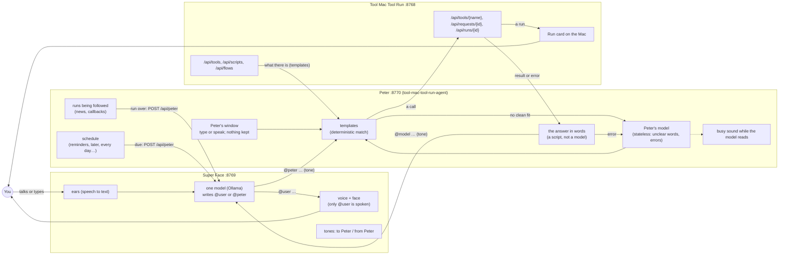

# How it fits together: Super Face, Peter, Tool Mac Tool Run

Three apps on one Mac, each with one job:

| App | Repository | Port | Its job |
|---|---|---|---|
| **Super Face** | [JUST-super-mac-tts-ONLY-service](https://github.com/ainigh/JUST-super-mac-tts-ONLY-service) | 8769 | The face and the conversation. It hears you, thinks with one model, and speaks. It does nothing itself: it asks Peter. |
| **Peter** (Tool Mac Agent) | [tool-mac-tool-run-agent](https://github.com/ainigh/tool-mac-tool-run-agent) | 8770 | Reads requests in plain words and carries them out on Tool Mac Tool Run. Answers in plain words. Keeps the schedule and calls clients back. Keeps no conversation. |
| **Tool Mac Tool Run** | [tool-mac-tool-run](https://github.com/ainigh/tool-mac-tool-run) | 8768 | The hands. Scripts, flows, the web, Chrome, notes, MEMORY, the mind, showing and copying, over an HTTP API. A run waits for you to click Run on the Mac. |

## The picture, in the end



### One request, start to end

```mermaid
sequenceDiagram
    participant U as You
    participant S as Super Face (model "qwen3")
    participant P as Peter
    participant M as Peter's model
    participant T as Tool Mac Tool Run

    U->>S: "gonna need an umbrella in Lagos tomorrow?" (shown as "@qwen3 …")
    S->>P: @peter will it rain in Lagos tomorrow (a tone, not spoken)
    P->>P: templates: no clean fit
    P->>M: what was said + the templates (no history); busy sound plays
    M-->>P: "what's the weather in Lagos" (0.9 sure)
    P->>T: POST /api/tools/run_script {weather.py, Lagos} (async)
    T-->>P: 202, waiting for Run on the Mac
    P-->>S: "@qwen3 Asked for the weather. I'll tell you how it goes." (a tone)
    S-->>U: "@user I've asked for the weather; click Run on your Mac." (spoken)
    U->>T: clicks Run
    T-->>P: (Peter follows the request) finished
    P->>S: POST /api/peter "Meanwhile: the weather finished … Lagos: 70% rain"
    S-->>U: "@user Yes, take an umbrella: 70% chance of rain." (spoken)
```

## The rules

- **Super Face talks only to Peter.** It never calls Tool Mac Tool Run, never loads its list of
  tools, and the model has no tools. Peter is a participant in the chat, not a tool.
- **The model's every answer is addressed.** `@user …` is said aloud to you; `@peter …` goes to
  Peter (a tone plays, nothing is said). Peter's answer comes back as `@<the model's name> …`, as
  if you had answered, and so does what you say. Peter's messages go to the model at once, even
  while you're talking; what you say goes when you finish, and its answer to you is spoken at once.
- **Peter keeps no conversation.** Each request is complete in itself. His model sees what was
  said, why it's asked, and the templates; never a history. What he does keep is operational: the
  runs he's following (so he can call back when they end) and the schedule (on disk).
- **Peter's answers are written by a script.** The model is asked only to read words that aren't a
  template, and to make sense of an error (and, when it can, to fix the request and try again once).
- **Peter keeps the time.** "Remind me in 20 minutes…", "every morning, what's the weather" are
  Peter's. When one comes due he does it and calls the client back (`POST /api/peter` for Super
  Face). One that came due while the client was closed comes first in its next answer.
- **Consent stays yours.** A run (a script, a flow, Flow code, Straw) waits for Run on the Mac, every
  time, including scheduled ones. Nothing a model says stands in for that click.
- **Each updates itself** from its GitHub releases, built and published by CI on every push to main.

## The plan

1. **Peter** (tool-mac-tool-run-agent), a menu bar app like Tool Mac Tool Run:
   - `PeterCore` (Foundation only, tested on Linux): Say's templates, matcher, words and translator,
     moved from Tool Mac Tool Run; a client for Tool Mac Tool Run's API (its tools, scripts and
     flows make the templates; every call goes through `POST /api/tools/{name}`); the stateless
     reading of each request; the model on errors; following runs and calling clients back; the
     schedule; the HTTP API (`POST /api/say`, `/api/schedules`, `/api/say/translator`…).
   - The app: its menu, a window to type or speak to Peter (each message on its own; nothing kept
     when it closes), the schedule, the model's settings, a distinct sound while the model is
     working, Check for updates.
   - `install.sh`, CI that tests on Linux and builds and releases on macOS, the docs (the Say API
     doc, the approach, the bench, moved here).
2. **Tool Mac Tool Run**: Say (`/api/say…`, the translator, the `say` tool) and Automation
   (`/api/automation`, the board, the tags, running by itself) taken out; scripts, flows, Composer and
   the rest stay. The docs say to talk to Peter.
3. **Super Face**: talks to Peter only (`http://127.0.0.1:8770`). `@peter` / `@user`, the chat as a
   group chat (`@qwen3 …`), Peter's messages to the model at once, a tone each way and never read
   aloud. Gone: the Clock and Later, the Tools, Calls and Mind tabs, the tools list, reading Tool Mac
   Tool Run. Kept: picking the model (beside the characters), the chat, Model, Prompts, Errors.

## Gaps, and how they're closed

| Gap | Closed by |
|---|---|
| Peter needs a model, and the one set may not be installed | He picks one Ollama has (the one set, else the best there is), and says so in his window. |
| A client that can't be called back (closed, or no address) | What it missed comes first in its next answer, as before. |
| A reminder that came due while Peter was closed | Done as he opens, saying it's late; over a day late, dropped. |
| Scheduled runs used to run without a click once allowed | They wait for Run each time now (the consent rule). Reminders and reads (the web, notes) need no click. |
| Super Face's playbook and standing instructions lived in Tool Mac Tool Run's library | Still there: Super Face asks Peter for them in words ("read the note Super Face playbook"), which is a template, answered without a model. |
| A client that used `/api/say` on Tool Mac Tool Run | The same API, on Peter's port. |
